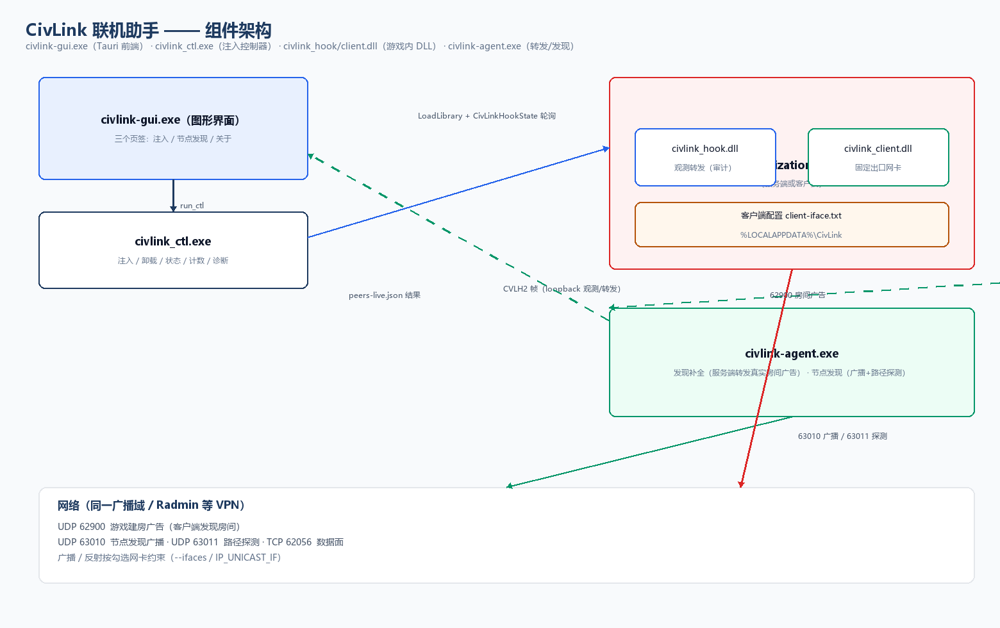
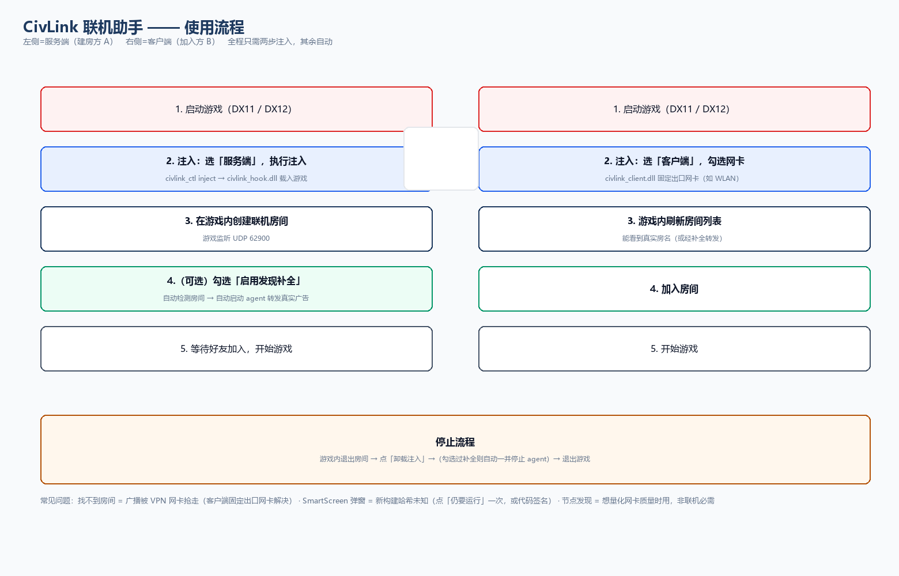
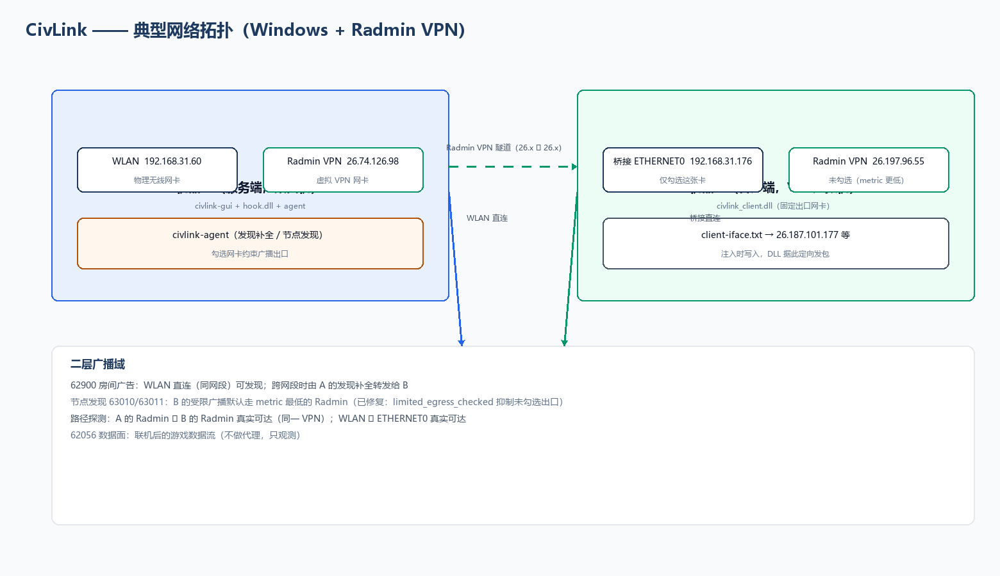

# 🏛️ CivLink 联机助手（Civ6-Link）

> 版本：**1.49**（2026-11-23） · 首版范围决议见 `docs/PROJECT-SCOPE-WIN-STEAM-2P.md` · 完整修订历史与实验手册见 `docs/M0A-MANUAL.md`

**《文明 6》局域网 / VPN 联机辅助工具** —— 解决「双方在同一 WiFi 或 Radmin 等 VPN 里，却互相找不到房间」的经典问题。

[](https://github.com/ShengTong1/Civ6-Link)
[](LICENSE)
[](civlink/agent)
[](civlink/gui-tauri)

---

## 它解决什么问题

文明 6 的局域网联机依赖 UDP 62900 广播发现房间。在两台机器之间有**多个网卡**（物理 WLAN + Radmin / ZeroTier 等 VPN 网卡）时：

- Windows 会挑 **metric 最小的网卡**发广播 → 广播从 VPN 网卡出去，同 WiFi 的另一台收不到 → 「找不到房间」；
- 或者广播域跨网段（一台走 VPN、一台走 WiFi）→ 互相看不见。

CivLink 把**出口网卡钉死在你勾选的网卡上**（`IP_UNICAST_IF`），并可选地把真实房间广告**转发到客户端可达的网络路径**，让联机稳定可复现。

## 快速上手（30 秒）

**服务端（建房方）**

1. 启动《文明 6》→ 打开 CivLink → 「注入」页选择进程（`CivilizationVI_DX12` / `CivilizationVI` / `CivilizationVI_DX11`）→ 勾选网卡 → **执行注入**；
2. 游戏内创建房间（监听 UDP 62900）；
3. （可选）勾选「启用发现补全」——检测到房间后自动启动，无需任何手动操作。

**客户端（加入方）**

1. 启动《文明 6》→ CivLink「注入」页选择进程 → 勾选**到服务端可达的网卡**（同 WiFi 选 WLAN，同 VPN 选对应网卡）→ **执行注入**；
2. 游戏内局域网列表刷新，即可看到真实房间名 → 加入。

**停止**：游戏内离开房间 → 「卸载注入」（发现补全自动一并停止）→ 退出游戏。

## 功能一览

| 功能 | 说明 |
|------|------|
| 🖱️ 三页签界面 | 注入 / 节点发现 / 关于 |
| 💉 注入 | 服务端 / 客户端角色切换；进程白名单（DX12 / DX11）；网卡勾选（含 VPN，显示接口名 + metric + 优先级）；卸载注入 |
| 📡 节点发现 | 勾选网卡 → 60s 持续广播 → **发现对端即内联探测**（几秒出结果）→ 路径表（丢包率 / p50 / p95 / 抖动）+ 推荐路径 |
| 🔁 发现补全 | 勾选即全自动：检测 UDP 62900 房间 → 启动 agent → 卸载时一并停止 |
| 📋 关于页 | 版本 / 作者 / 项目地址 + 一键脱敏诊断导出（status + counters + 日志） |

## 工作原理

**注入（出口定向）** —— `civlink_client.dll` 载入游戏后读取 `client-iface.txt`（写入了你勾选的网卡 IP），对游戏的广播 / 探针套用 `IP_UNICAST_IF`，强制从指定网卡发出。`civlink_hook.dll` 只做观测转发（始终调用原始 API，绝不改写游戏行为，B2 审计模式）。

**节点发现（像 ping 一样快）** —— agent 保持 60s 广播窗口不中断；一旦发现对端，3 秒后立即内联探测所有「本机勾选网卡 × 对端地址」组合（每路径 100 根探针、死路径 15 根即放弃、`IP_PKTINFO` 按到达网卡过滤，杜绝未勾选网卡掺和），结果实时发布。

**发现补全（服务端专用）** —— agent 绑定 62901–62999（不碰 62900，留给游戏建房），把收到的客户端发现请求转发给本机游戏、再把游戏的真实房间广告原样转发回去（fail-closed：游戏不应答则客户端什么都拿不到，绝不伪造房间）。

**计时** —— done 相位冻结结果发布时间（不虚长「已用 59s」），倒计时基准与广播窗口统一。

## 图片

<div align="center">

### 组件架构



### 使用流程



### 网络拓扑（Windows + Radmin VPN 示例）



</div>

## 构建

| 产物 | 命令 | 依赖 |
|------|------|------|
| `civlink_hook.dll` / `civlink_client.dll` / `civlink_ctl.exe` | `civlink/build-msvc.cmd` | MSVC x64（vcvars64）+ MinHook v1.3.4（submodule），`/MT` 静态 CRT |
| `civlink-agent.exe` | `cd civlink/agent && cargo build --release --features peer-discover --target-dir target-175` | Rust **1.75** 固定工具链 |
| `civlink-gui.exe` | `cd civlink/gui-tauri/src-tauri && cargo build --release` | cargo 1.99，Cargo.lock 保持 **v3** |

> 注：agent 依赖（if-addrs / socket2）已 vendor 到 `civlink/agent/vendor/`，可离线构建。

## 测试

| 测试 | 结果 |
|------|------|
| `run-c2-iface-selftest.ps1`（C2 记账层） | **50/50 runner checks + 74 in-process**（场景 A–J，含换网卡重新激活 J） |
| `hook_selftest.exe`（hook 透传 / 计数闭合） | PASS（0 failure） |
| `civlink-agent.exe --peer-discover-selftest`（core 纯检查） | **36/0** |
| 变异 harness（core 打洞检测） | **6/0** |

## 仓库结构

```
CivLink-M0A-audit/
├── civlink/
│   ├── agent/        # 节点发现 / 发现补全 agent（Rust，零外部依赖默认构建）
│   ├── hook/         # civlink_hook.dll（观测透传）
│   ├── client/       # civlink_client.dll（客户端出口网卡钉死）
│   ├── ctl/          # civlink_ctl.exe（注入 / 卸载 / 状态 / 计数 / 诊断）
│   ├── gui-tauri/    # civlink-gui.exe（Tauri 桌面界面）
│   ├── common/       # cvlh2.h（协议帧）、civlink_hook.h、civlink_client.h
│   └── selftest/     # C++ 自检（client / hook / fakeip）
├── docs/             # 实验手册、交接文档、范围决议、审计报告
├── M0A/              # 审计证据与运行记录（captures）
├── scripts/          # 构建 / 自检 / 预检脚本
├── dist/             # 发布包（zip）
└── deps/             # MinHook v1.3.4（submodule）
```

## 文档

| 文档 | 内容 |
|------|------|
| [`docs/M0A-MANUAL.md`](docs/M0A-MANUAL.md) | 实验手册（章节 0–10 + v1.1–v1.49 修订记录） |
| [`docs/CODEX-HANDOVER-M0A.md`](docs/CODEX-HANDOVER-M0A.md) | AI 交接 / 登记链 |
| [`docs/HANDOVER-TO-NEXT-AI-20261120.md`](docs/HANDOVER-TO-NEXT-AI-20261120.md) | 项目交接文档（2026-11-20） |
| [`docs/PROJECT-SCOPE-WIN-STEAM-2P.md`](docs/PROJECT-SCOPE-WIN-STEAM-2P.md) | 首版范围决议（Windows + Steam + 双人） |
| [`CONTRIBUTING.md`](CONTRIBUTING.md) / [`SECURITY.md`](SECURITY.md) | 贡献指南 / 漏洞报告 |

## 常见问题

**为什么客户端不需要「发现补全」？** —— 补全把**本机**的真实房间广告转发出去；客户端没有本地房间可转发。客户端需要的是出口定向（注入），两者互补而非重复。

**SmartScreen 弹「已保护你的电脑」？** —— 新构建的 exe 哈希未知，属正常。点「更多信息 → 仍要运行」一次即可（SmartScreen 会记住该哈希）；要彻底消除需 EV 代码签名证书。

**节点发现显示某条路径 100% 丢包？** —— 那是真实测量结果（跨网段交叉组合本就不可达，agent 会提前放弃并标注）。推荐路径永远选丢包率最低的组合。

## 许可

- 代码：**MIT**（`LICENSE`，Copyright (c) 2026 shengtong）
- 文档：**CC BY 4.0**（`docs/LICENSE-DOCS.md`）
- 第三方：MinHook v1.3.4（BSD-2，见 `THIRD-PARTY-NOTICES.md`）
